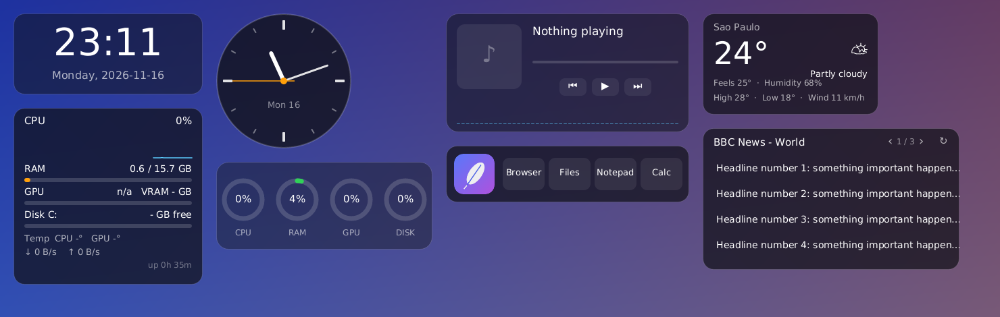

# Plume

Lightweight desktop widgets for Windows, in the spirit of Rainmeter, written in Rust and built to use as little CPU and RAM as possible.



## Features
- Transparent widgets drawn on the desktop, always on top or in a normal window layer. You can drag them, make them click-through and set their opacity.
- Text, rectangles, bars, line graphs, circular gauges, images and an audio visualizer.
- Variables, math and conditions in any text, color or value: `{cpu > 80 ? 'HOT' : 'ok'}`.
- CPU, RAM, GPU, VRAM, disks, temperatures, network, battery, uptime and date/time.
- Now playing (Spotify, browsers, players...) with cover art and media controls.
- Internet data: any JSON API, plus RSS/Atom feeds.
- **LuaJIT** scripts for anything the TOML can't express.
- Click, right-click, middle-click and scroll actions: open apps, URLs and folders, control media and volume, set variables, call Lua.
- Hover effects, rotation, blur and acrylic backgrounds.
- Widgets reload automatically when you save their files.
- A system tray icon, an option to start with Windows, and a log file.

## Why it is light
- Talks to the Win32 API directly: no UI framework, no webview.
- Each widget is a *layered* window (`UpdateLayeredWindow`) with per-pixel transparency.
- Drawing is done in software (`tiny-skia`), and text with `fontdue` plus a glyph cache.
- **Only what is used gets measured.** If no widget shows the GPU, the GPU is never queried. The audio, media and internet background threads only start when a widget needs them, and audio capture stops when nothing reads it.
- System metrics are sampled at most once per second and shared by every widget.
- Hidden widgets are not redrawn at all.
- Downloads use WinHTTP, which is built into Windows, so no TLS library is bundled.

## Build and run (on Windows)
```
cargo build --release
target\release\plume.exe
```
On first run it creates a `widgets\` folder next to the `.exe` with examples.
You can also point it at another folder: `plume.exe C:\my\widgets`.

- **Tray icon:** left click shows/hides all widgets; right click opens the menu.
- **Menu** (tray icon or right click on a widget): *Show/Hide widgets*, *Reload widgets*, *Open widgets folder*, *Install example widgets*, *Open log*, *Start with Windows* and *Exit*.
- **Drag:** drag any part of a widget that is not clickable. Positions are saved in `widgets\positions.state`.
- **Errors** in widget files show up as a notification and are written to `widgets\plume.log`.
- **PNG preview** (works on any OS): `plume --preview widgets`

## Examples
| File | Shows |
|---|---|
| `clock.toml` | Digital clock with a blurred background |
| `system.toml` | CPU graph with a conditional color, RAM, GPU, disk, temperatures, network, battery |
| `analog-clock.toml` | Rotation driven by expressions, hover opacity |
| `gauges.toml` | Circular gauges, colors from `[variables]`, acrylic background |
| `media.toml` | Now playing, cover art, media buttons, volume on scroll, audio visualizer |
| `weather.toml` + `weather.lua` | JSON API (open-meteo, no key) + LuaJIT script |
| `news.toml` | RSS reader with clickable headlines and paging (`!set`) |
| `launcher.toml` | Image, app buttons with hover effects |

Set `enabled = false` in a file to turn a widget off.

## Widget format (`widgets/*.toml`)
```toml
name = "my-widget"      # unique
enabled = true
x = 100
y = 100
width = 250
height = 100
update_ms = 1000        # how often data is refreshed (16 = 60 fps)
z = "bottom"            # bottom (on the desktop) | normal | top (always on top)
opacity = 255           # 0-255
hover_opacity = 255     # opacity while the mouse is over the widget (optional)
draggable = true
click_through = false
font = "C:/Windows/Fonts/segoeui.ttf"
script = "my-widget.lua"   # optional, LuaJIT

[variables]             # your own values; strings can contain {expressions}
accent = "#5AC8FA"
limit = 80
label = "CPU {cpu}%"

[background]
color = "#101018C0"     # #RRGGBB or #RRGGBBAA, or an expression
radius = 12
border = "#FFFFFF30"
border_width = 1
blur = "none"           # none | blur | acrylic

[[web]]                 # data from the internet (optional, any number)
name = "weather"
url = "https://api.example.com/data?city={city}"
interval = 600          # seconds
format = "json"         # json | rss | text

[[element]]
type = "text"
x = 10
y = 10
text = "{label}"
```

### Elements
| `type` | Fields |
|---|---|
| `text` | x, y, text, size, color, align (`left`/`center`/`right`), font |
| `rect` | x, y, w, h, color, radius, border, border_width |
| `bar` | x, y, w, h, value, min (0), max (100), color, background, radius, vertical |
| `graph` | x, y, w, h, value, min, max, color, fill, line_width, step |
| `ring` | x, y (center), radius, thickness, value, min, max, color, background, start (-90), sweep (360), round_caps |
| `image` | x, y, w, h, path, hover_path, radius, opacity (0-1). PNG, JPG, BMP or ICO. |
| `spectrum` | x, y, w, h, bars, color, gap, radius. Shows what the speakers are playing. |

Fields every element has:

| Field | |
|---|---|
| `visible` | Expression; the element is only drawn while it is true. |
| `on_click`, `on_right_click`, `on_middle_click`, `on_scroll_up`, `on_scroll_down` | One action or a list of actions. |
| `hover_color` | Color used while the mouse is over the element. |
| `rotate` | Degrees; can be an expression (`"second * 6"`). |
| `rotate_center` | `[x, y]` pivot, in widget coordinates. Defaults to the element's center. |

Colors can be fixed (`"#FF8800"`) or expressions (`"cpu > 80 ? '#FF3B30' : accent"`).

### Expressions
Everything inside `{...}` in text, and the `value`, `visible`, `rotate` and color fields, is an expression:

```
cpu * 2                     + - * / %
cpu > 80 ? "HOT" : "ok"     comparisons, && || ! (also and/or/not), ternary
if(battery < 20, "low", "") functions
weather.current.temp        dotted paths into web data and Lua tables
"CPU " + cpu + "%"          joins text
```
Numbers keep a sensible number of decimals: `cpu` shows none, `ram_used` shows one. Use `round(x, n)` to choose.

**Functions:** `round(x, n)`, `floor`, `ceil`, `abs`, `min`, `max`, `clamp(x, lo, hi)`, `if(c, a, b)`, `default(x, fallback)`, `is_null(x)`, `num`, `str`, `upper`, `lower`, `len`, `trunc(text, n)`, `pad(x, width)`, `fmt_bytes(n)`, `fmt_time(seconds)`, `time(format)`, `disk(drive)`, `disk_used(drive)`, `disk_free(drive)`, `disk_total(drive)`, `get('dynamic.path')`, `web_ready(name)`, `lua(function, args...)`.

**Variables:**

| | |
|---|---|
| CPU / memory | `cpu`, `ram`, `ram_used`, `ram_total`, `ram_free` (GB) |
| GPU | `gpu` (%), `gpu_mem` (%), `gpu_mem_used`, `gpu_mem_total` (GB) |
| Temperatures | `cpu_temp`, `gpu_temp` (°C) |
| Disk | `disk`, `disk_used`, `disk_free`, `disk_total` (drive C:, or use the functions) |
| Network | `net_down`, `net_up` (text, e.g. "1.2 MB/s"), `net_down_bytes`, `net_up_bytes` |
| Battery | `has_battery`, `battery`, `battery_charging`, `battery_plugged`, `battery_time` |
| Media | `media_title`, `media_artist`, `media_album`, `media_playing`, `media_active`, `media_status`, `media_position`, `media_duration` (s), `media_progress` (%), `media_cover` (use as an image `path`) |
| Audio | `audio_level` (0-100) |
| Time | `hour`, `hour12`, `minute`, `second`, `day`, `month`, `year`, `weekday`, `uptime`, `uptime_s`, `time('%H:%M')` ([chrono format](https://docs.rs/chrono/latest/chrono/format/strftime/)) |

A sensor that is not available gives `null`, which shows as empty text. Use `default(gpu_temp, '-')` to show something else.

### Actions
```
https://example.com            open a URL, file, folder or program
"C:\Path\app.exe" --arg        program with arguments (quote the path)
assets/readme.txt              paths are relative to the widgets folder
!reload  !exit                 reload widgets / quit Plume
!hide  !show  !toggle          all widgets
!toggle:clock                  show/hide one widget by name
!refresh                       update this widget now
!set:name=expression           set a variable (e.g. !set:page = page + 1)
!lua:function                  call a function of the widget's script
!media:playpause | next | prev | stop
!volume:up | down | mute
```
Actions are templates too: `on_click = "{news.items.0.link}"`.

### Lua scripts (LuaJIT)
```lua
-- update() runs on every widget update; the table it returns becomes variables.
function update()
  local cpu = plume.get("cpu")
  return { status = cpu > 80 and "Busy" or "Idle", info = { cores = 8 } }  -- {status}, {info.cores}
end

-- Any function can be used in expressions ({lua('double', cpu)}) or actions (!lua:clicked).
function double(x) return x * 2 end
function clicked() plume.set("count", (plume.get("count") or 0) + 1) end
```
- **Host API:** `plume.get(name)`, `plume.eval("expression")`, `plume.set(name, value)` (persistent variable), `plume.run("action")`, `plume.log(...)`, `plume.widget`.
- **Optional `init()`:** called once after the script loads.
- **Sandbox:** scripts get `string`, `table`, `math`, `bit`, `jit` and `os.time/date/clock`. File access (`io`), `require` and running programs are not available, so a downloaded widget cannot touch your files.

## Notes and limits
- **CPU temperature** uses Windows' ACPI sensor, which many PCs do not expose (or only to admin). **GPU temperature** works with NVIDIA drivers. A missing sensor shows as `null`.
- **Blur/acrylic** uses the same Windows API as Rainmeter's blur plugins. On some Windows 10 builds acrylic makes dragging feel slow; use `blur` there.
- **Media** works with any app that shows up in the Windows media overlay.
- Symbols missing from the chosen font (♪ ☀ ⏯ ...) are taken automatically from Segoe UI Symbol or Segoe UI Emoji.

## Project layout
| File | Role |
|---|---|
| `src/config.rs` | TOML format |
| `src/expr.rs` | Expression language and templates |
| `src/widget.rs` | Widget runtime: variables, script and state |
| `src/render.rs` | Drawing (cross-platform) |
| `src/metrics.rs`, `src/probe.rs` | System data, battery, GPU, temperatures |
| `src/media.rs`, `src/audio.rs` | Now playing, audio loopback + FFT |
| `src/web.rs` | Downloads, JSON and RSS |
| `src/script.rs` | LuaJIT |
| `src/actions.rs` | Click actions |
| `src/win.rs`, `src/tray.rs` | Windows, mouse, timers, auto-reload, blur, tray |
